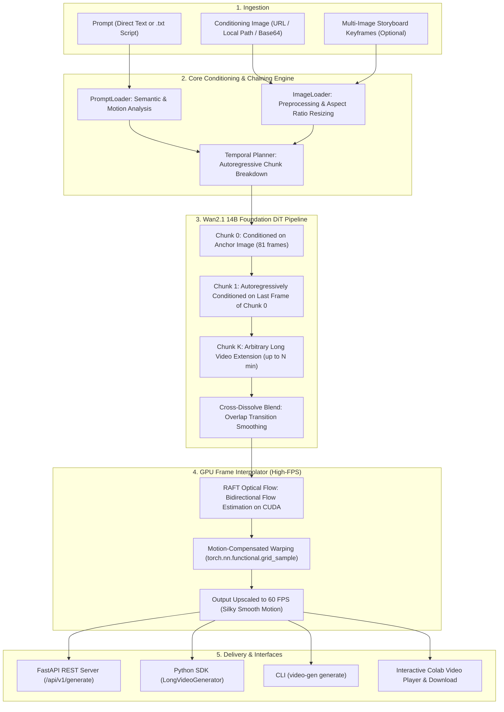

# 🎬 Long Video Generation Prototype

An extensible, production-ready framework for generating continuous long videos (default **10 seconds**, scaleable to **minutes**) from text prompts and conditioning images. Powered by **Wan2.1 14B Diffusion Transformer (DiT)** foundation model, **Deep Learning Optical Flow GPU Frame Interpolation (16 fps → 60 fps)**, autoregressive chunk chaining with seamless cross-dissolve transitions, **FastAPI REST API**, and optimized specifically to maximize the **NVIDIA L4 GPU (24GB VRAM)**.

---

## 🌟 Key Features

- **Default Flagship Model: Wan2.1 14B Image-to-Video**:
  - Utilizes Alibaba's cutting-edge **Wan2.1-I2V-14B-480P** Diffusion Transformer foundation model.
  - Native 16 fps generation at 832×480 resolution (16:9 widescreen).
  - 81 frames per chunk (~5.06s) chained autoregressively for continuous, artifact-free long-duration videos.
- **High-FPS GPU Frame Interpolation (16 fps → 60+ fps)**:
  - **Deep Optical Flow (RAFT)**: Recurrent All-Pairs Field Transforms computing bidirectional flow fields on GPU for motion-compensated warping. Eliminates ghosting and motion blur.
  - **Batched GPU Tensor Blending**: Parallel CUDA tensor arithmetic for ultrafast frame rate doubling/quadrupling.
  - Arbitrary target framerate support (e.g. 30 fps, 60 fps, 120 fps) or integer multipliers (2x, 4x, 8x).
- **Engineered to Maximize NVIDIA L4 GPU (24GB VRAM)**:
  - **Precision**: `bfloat16` native to Ada Lovelace (compute capability 8.9) tensor cores.
  - **Sequential Model CPU Offloading**: Allows the full 14B parameter model and activations to fit and run at high throughput within 24GB VRAM.
  - **3D VAE Slicing & Tiling**: Chunked spatial/temporal latent decoding prevents VRAM spikes during 81-frame decoding passes.
- **Multi-Pipeline Architecture**:
  - `WanVideoPipeline` (**Default**): Alibaba Wan2.1 14B Image-to-Video foundation model.
  - `SVDPipeline`: Stable Video Diffusion XT (`stabilityai/stable-video-diffusion-img2vid-xt`).
  - `LTXVideoPipeline`: Lightricks LTX-Video DiT (`Lightricks/LTX-Video`).
  - `MockVideoPipeline`: High-speed procedural mock pipeline (<0.1s/chunk) for CI/CD, testing, and offline execution without GPU.
- **Dual Conditioning (Prompt + Image)**:
  - **Prompt**: Direct string or loaded from `.txt` script with dynamic motion analysis.
  - **Image**: Web URL (auto-downloaded), local path, base64 data URI, or multiple images for multi-scene storyboarding.
- **Full-Featured API**:
  - FastAPI server with `/api/v1/generate`, `/api/v1/generate/upload` (multipart), `/api/v1/jobs/{job_id}` (async progress polling), and `/api/v1/videos/{video_id}` (streaming & download).
  - OpenAPI / Swagger UI at `/docs`.
- **Interactive Colab & Jupyter Integration**:
  - Responsive in-notebook HTML5 player with interactive controls and instant download button.

---

## 🏗️ Architecture



---

## 🚀 Video Models on NVIDIA L4 GPU (24GB VRAM)

| Model | Pipeline Key | Architecture | Resolution | Native FPS | Interpolated FPS | VRAM Footprint | Best For |
|---|---|---|---|---|---|---|---|
| **Wan 2.1 14B** (**Default**) | `wan` | 14B DiT (Diffusion Transformer) | 832×480 / 720p | 16 fps | **60 fps** | ~18–22 GB (bfloat16 + offload) | SOTA photorealism, complex motion, visual fidelity |
| **LTX-Video** | `ltx_video` | 2B DiT | 704×480 / 768×512 | 24–25 fps | **60 fps** | ~8–12 GB (bfloat16) | Fast generation, high native framerate |
| **SVD-XT** | `svd_xt` | Latent U-Net | 1024×576 | 7 fps | **30–60 fps** | ~6–14 GB (float16) | Camera motion, steady landscapes |
| **Procedural Mock** | `mock` | CPU Synthetic Waveform | Configurable | Any | Any | < 100 MB | Instant CI testing, local CPU validation |

---

## ⚡ Quickstart

### 1. Installation

```bash
# Clone repository
git clone https://github.com/khangtruong-ui/video-generation-prototype.git
cd video-generation-prototype

# Install dependencies and package in editable mode
pip install -e .
```

### 2. Python SDK

```python
from video_gen import LongVideoGenerator, VideoConfig

# 1. Initialize generator with L4 GPU preset (Wan2.1 14B + 60 FPS interpolation)
config = VideoConfig.for_l4_gpu(
    duration_seconds=10.0,
    fps=16,
    target_fps=60,  # GPU optical-flow interpolation to 60 FPS
    num_inference_steps=30,
)
generator = LongVideoGenerator(config=config)

# 2. Generate long video (10s continuous video at 60 FPS)
result = generator.generate(
    prompt="Cinematic drone flight across misty mountain peaks at golden hour sunset, 8k photorealistic",
    image="https://images.unsplash.com/photo-1506744038136-46273834b3fb?w=832&q=80",
    duration_seconds=10.0,
    target_fps=60,
    output_path="outputs/wan_mountain_60fps.mp4",
)

print(f"Video saved to: {result.video_path}")
print(f"Duration: {result.duration_seconds}s | Frames: {result.num_frames} @ {result.fps} fps")
```

### 3. GPU Frame Interpolation Standalone API

You can also use the high-performance GPU Frame Interpolator directly on any frame sequence:

```python
from PIL import Image
from video_gen import GPUFrameInterpolator, interpolate_frames

# Method 1: Functional helper
interpolated_frames = interpolate_frames(
    frames=my_frames,
    target_fps=60,
    source_fps=16,
    method="raft",  # Deep learning optical flow on CUDA
)

# Method 2: Object-oriented interpolator class
interpolator = GPUFrameInterpolator(device="cuda", model_name="raft_small")
smooth_frames, final_fps = interpolator.interpolate_sequence(
    frames=my_frames,
    target_fps=60,
    source_fps=16,
    method="raft",
)
```

### 4. Interactive Colab / Jupyter Display & Download API

```python
from video_gen import LongVideoGenerator, VideoConfig, display_video, download_video

# Generate video
config = VideoConfig.for_l4_gpu(duration_seconds=10.0, target_fps=60)
generator = LongVideoGenerator(config=config)
result = generator.generate(
    prompt="Majestic waterfall cascading through lush rainforest canopy",
    image="https://images.unsplash.com/photo-1506744038136-46273834b3fb?w=832&q=80",
)

# Display interactive HTML5 player with download button
display_video(
    result,
    width=720,
    autoplay=True,
    loop=True,
    include_download=True,
    title="🎬 60 FPS Rainforest Waterfall",
)

# Or trigger native Colab file download:
download_video(result.video_path)
```

Interactive demo notebooks are ready to run:
- [`examples/video_generation_demo.ipynb`](examples/video_generation_demo.ipynb)
- [`VideoGenerationTest.ipynb`](VideoGenerationTest.ipynb)

### 5. Command Line Interface (CLI)

```bash
# Generate 10s video on L4 GPU using default Wan2.1 14B + 60 FPS interpolation
video-gen generate \
  --prompt "Cinematic flythrough over a sunlit autumn forest, 8k" \
  --image "https://images.unsplash.com/photo-1506744038136-46273834b3fb?w=832&q=80" \
  --duration 10.0 \
  --fps 16 \
  --target-fps 60 \
  --output outputs/wan_forest_60fps.mp4

# Generate using prompt script (.txt)
video-gen generate \
  --prompt-file examples/sample_storyboard.txt \
  --duration 10.0 \
  --target-fps 60 \
  --output outputs/storyboard_60fps.mp4

# Run with fast procedural mock pipeline for instant local test (no GPU required)
video-gen generate --mock --duration 4.0 --target-fps 30 --output outputs/mock.mp4

# Check GPU memory diagnostics and RAFT optical flow support
video-gen info

# Start FastAPI server
video-gen serve --host 0.0.0.0 --port 8000
```

---

## 🌐 REST API Reference

Launch the server with `video-gen serve --port 8000`. Interactive Swagger UI is available at `http://localhost:8000/docs`.

### 1. Generate Video (Synchronous)

```bash
curl -X POST "http://localhost:8000/api/v1/generate" \
  -H "Content-Type: application/json" \
  -d '{
    "prompt": "Cinematic aerial camera gliding smoothly over majestic natural scenery, sunset lighting",
    "image": "https://images.unsplash.com/photo-1506744038136-46273834b3fb?w=832&q=80",
    "duration_seconds": 10.0,
    "fps": 16,
    "target_fps": 60,
    "pipeline_type": "wan",
    "async_mode": false
  }'
```

**Response:**
```json
{
  "video_id": "gen_8e19ad04ef51",
  "status": "completed",
  "download_url": "/api/v1/videos/gen_8e19ad04ef51",
  "stream_url": "/api/v1/videos/gen_8e19ad04ef51/stream",
  "duration_seconds": 10.12,
  "fps": 60,
  "num_frames": 608,
  "num_chunks": 2,
  "metadata": {
    "pipeline": "wan",
    "source_fps": 16,
    "fps": 60,
    "interpolated": true,
    "interpolate_method": "auto",
    "device": "cuda",
    "execution_time_seconds": 65.4
  }
}
```

### 2. Generate Video (Asynchronous / Background Job)

```bash
curl -X POST "http://localhost:8000/api/v1/generate" \
  -H "Content-Type: application/json" \
  -d '{
    "prompt": "A continuous 30-second camera flyover across mountain ranges",
    "duration_seconds": 30.0,
    "target_fps": 60,
    "async_mode": true
  }'
```

**Query Progress:**
```bash
curl "http://localhost:8000/api/v1/jobs/gen_8e19ad04ef51"
```

### 3. Stream & Download Video

```bash
# Inline browser streaming
GET /api/v1/videos/{video_id}/stream

# Direct file download
GET /api/v1/videos/{video_id}
```

### 4. System Health & Hardware Diagnostics

```bash
GET /api/v1/health
```

---

## 🧪 Testing

The repository maintains an extensive test suite verifying configuration presets, pipelines, API routes, Colab helpers, and GPU frame interpolation:

```bash
# Run full test suite
PYTHONPATH=. pytest

# Run specific test modules
PYTHONPATH=. pytest tests/test_wan_pipeline.py
PYTHONPATH=. pytest tests/test_interpolator.py
PYTHONPATH=. pytest tests/test_generator.py
```

---

## 📄 License

MIT License. See [LICENSE](LICENSE) for details.
