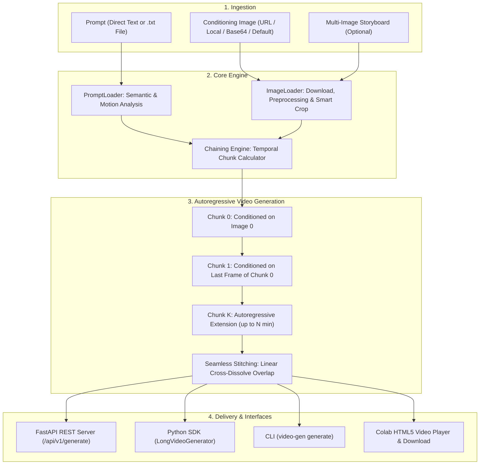

# 🎬 Long Video Generation Prototype

An extensible, production-ready prototype for generating continuous long videos (default **10 seconds**, scaleable to **minutes**) from text prompts and conditioning images. Powered by **Stable Video Diffusion XT (SVD-XT)**, autoregressive chunk chaining with seamless cross-dissolve transitions, **FastAPI REST API**, and optimized specifically for the **NVIDIA L4 GPU (24GB VRAM)**.

---

## 🌟 Key Features

- **Long Video Generation**: Generates 10-second videos by default (and extends seamlessly to 30s, 60s, or minutes) using autoregressive temporal chunk chaining and cross-dissolve frame blending.
- **Dual Conditioning (Prompt + Image)**:
  - **Prompt**: Direct string or loaded from a `.txt` file script with automatic motion dynamics analysis (adjusts `motion_bucket_id` based on prompt cues).
  - **Image**: Web URL (auto-downloaded), local file path, base64 data URI, or multiple images for multi-scene storyboarding. Defaults to a curated high-resolution internet landscape if omitted.
- **NVIDIA L4 GPU Optimized**:
  - Precision: `float16`
  - VRAM Footprint: ~6–14GB (well within the 24GB L4 limit)
  - Memory Optimizations: VAE chunked latent decoding (`decode_chunk_size=8`), attention slicing, and memory cache management.
- **Dual Pipeline Architecture**:
  - `SVDPipeline`: High-fidelity image-to-video generation using `stabilityai/stable-video-diffusion-img2vid-xt`.
  - `MockVideoPipeline`: Ultra-fast procedural mock pipeline (<0.1s/chunk) for CI/CD, unit testing, and instant local debugging without GPU.
- **Full-Featured API**:
  - FastAPI server with `/api/v1/generate`, `/api/v1/generate/upload` (multipart), `/api/v1/jobs/{job_id}` (async progress polling), and `/api/v1/videos/{video_id}` (streaming & download).
  - OpenAPI / Swagger UI at `/docs`.
- **Modular & Extensible**:
  - Abstract `BaseVideoPipeline` interface allows easily plugging in future models (e.g., CogVideoX, Wan, LTX, I2VGen-XL).
  - Pluggable backends: `LocalRunner` for the current L4 GPU, plus a turnkey `modal_runner.py` scaffold for future Modal cloud scaling.
- **Interactive Colab Notebook**: In-browser video player, progress tracking, and one-click download.

---

## 🏗️ Architecture



---

## ⚡ Quickstart

### 1. Installation

```bash
# Clone and enter repo
git clone https://github.com/khangtruong-ui/video-generation-prototype.git
cd video-generation-prototype

# Install dependencies and package in editable mode
pip install -e .
```

### 2. Python API

```python
from video_gen import LongVideoGenerator, VideoConfig

# 1. Initialize generator with L4 GPU preset
config = VideoConfig.for_l4_gpu(
    duration_seconds=10.0,
    fps=7,
    num_inference_steps=25,
)
generator = LongVideoGenerator(config=config)

# 2. Generate long video (10s = 71 frames across 3 chained chunks)
result = generator.generate(
    prompt="Cinematic drone flight across misty mountain peaks at sunset, 8k photorealistic",
    image="https://images.unsplash.com/photo-1506744038136-46273834b3fb?w=1024&q=80",
    duration_seconds=10.0,
    fps=7,
    output_path="outputs/my_video.mp4",
)

print(f"Video saved to: {result.video_path}")
print(f"Duration: {result.duration_seconds}s | Frames: {result.num_frames}")
```

### 3. Command Line Interface (CLI)

```bash
# Generate 10s video on L4 GPU
video-gen generate \
  --prompt "Cinematic flythrough over a sunlit autumn forest" \
  --image "https://images.unsplash.com/photo-1506744038136-46273834b3fb?w=1024&q=80" \
  --duration 10.0 \
  --fps 7 \
  --output outputs/cli_video.mp4

# Generate using prompt file (.txt)
video-gen generate \
  --prompt-file examples/sample_storyboard.txt \
  --duration 10.0 \
  --output outputs/storyboard.mp4

# Run with mock pipeline (instant testing without GPU)
video-gen generate --mock --duration 5.0 --output outputs/mock.mp4

# Start FastAPI server
video-gen serve --host 0.0.0.0 --port 8000
```

---

## 🌐 REST API Reference

Launch the server with `video-gen serve --port 8000`. The interactive Swagger UI is available at `http://localhost:8000/docs`.

### 1. Generate Video (Synchronous)

```bash
curl -X POST "http://localhost:8000/api/v1/generate" \
  -H "Content-Type: application/json" \
  -d '{
    "prompt": "Cinematic aerial camera gliding smoothly over majestic natural scenery, sunset lighting",
    "image": "https://images.unsplash.com/photo-1506744038136-46273834b3fb?w=1024&q=80",
    "duration_seconds": 10.0,
    "fps": 7,
    "async_mode": false
  }'
```

**Response:**
```json
{
  "video_id": "gen_8e19ad04ef51",
  "status": "completed",
  "download_url": "/api/v1/videos/gen_8e19ad04ef51",
  "stream_url": "/api/v1/videos/gen_8e19ad04ef51/stream",
  "duration_seconds": 10.14,
  "fps": 7,
  "num_frames": 71,
  "num_chunks": 3,
  "metadata": {
    "pipeline": "svd_xt",
    "device": "cuda",
    "execution_time_seconds": 45.2
  }
}
```

### 2. Generate Video (Asynchronous / Background Job)

```bash
curl -X POST "http://localhost:8000/api/v1/generate" \
  -H "Content-Type: application/json" \
  -d '{
    "prompt": "A continuous 30-second camera flyover across mountain ranges",
    "duration_seconds": 30.0,
    "async_mode": true
  }'
```

**Check Job Progress:**
```bash
curl "http://localhost:8000/api/v1/jobs/gen_8e19ad04ef51"
```

**Response:**
```json
{
  "job_id": "gen_8e19ad04ef51",
  "status": "processing",
  "progress_percent": 66.7,
  "message": "Chunk 2/9: Denoising step 18/25"
}
```

### 3. File Upload Endpoint (`multipart/form-data`)

```bash
curl -X POST "http://localhost:8000/api/v1/generate/upload" \
  -F "prompt_file=@examples/sample_storyboard.txt" \
  -F "image=@my_photo.jpg" \
  -F "duration_seconds=10.0"
```

### 4. Health & GPU Diagnostics

```bash
curl "http://localhost:8000/api/v1/health"
```

---

## 🎮 How Long Video Chaining Works

Standard Image-to-Video diffusion models generate short isolated clips (typically 14 or 25 frames, $\approx 3.5$ seconds at 7 fps). To generate coherent videos of **10 seconds up to minutes**:

1. **Chunk Calculation**:
   - At 7 fps, a 10s video requires $\approx 70$ frames.
   - Using 25 frames per chunk with 2 overlapping transition frames ($M=2$), each subsequent chunk adds $25 - 2 = 23$ unique frames.
   - Chunks needed: $1 + \lceil (70 - 25) / 23 \rceil = 3$ chunks (71 total stitched frames = $10.14$ seconds).
2. **Autoregressive Conditioning**:
   - Chunk 0 is conditioned on the input image.
   - Chunk 1 is conditioned on the **last frame of Chunk 0** with low noise augmentation (`noise_aug_strength=0.02`), preserving visual consistency.
   - Chunk $k$ is conditioned on the last frame of Chunk $k-1$.
3. **Cross-Dissolve Smoothing**:
   - Adjacent chunks overlap by $M$ frames and are blended using linear alpha cross-dissolve:
     $$F_{\text{blend}}[i] = (1 - \alpha) \cdot A[K - M + i] + \alpha \cdot B[i]$$
   - This eliminates sudden seam cuts between chunks.
4. **Multi-Image Mode**:
   - When multiple images are provided (e.g. 3 images), the planner assigns each image as a keyframe anchor across the chunks, allowing multi-scene cinematic narratives.

---

## 🚀 Scaling to Modal (Future GPU Runner)

When scaling to cloud GPUs on [Modal](https://modal.com/):

```bash
# 1. Install modal and authenticate
pip install modal
modal setup

# 2. Deploy or run on Modal L4 / A100 GPU
modal run video_gen/backends/modal_runner.py --prompt "cinematic flyover" --duration 10
modal deploy video_gen/backends/modal_runner.py
```

The `video_gen/backends/modal_runner.py` module defines the cloud container image, persistent volume model caching, and `@app.cls(gpu="L4")` execution.

---

## 🧪 Testing

The repository includes a comprehensive test suite (31 tests covering config, loaders, chaining mathematics, video encoding, pipelines, and FastAPI endpoints):

```bash
pytest -v
```

All unit and API tests use the `MockVideoPipeline`, executing the full test suite in **< 2 seconds** on CPU.

---

## 📁 Repository Structure

```
video-generation-prototype/
├── video_gen/
│   ├── config.py           # Typed dataclasses, L4 preset, Mock preset
│   ├── generator.py        # Master LongVideoGenerator & GenerationResult
│   ├── core/
│   │   ├── image_loader.py # Multi-source image ingestion (URL, base64, path, default)
│   │   ├── prompt_loader.py# Script parsing & motion bucket inference
│   │   ├── chaining.py     # Autoregressive chunk planner & cross-dissolve blending
│   │   └── video_utils.py  # H.264 MP4 encoding & metadata extraction
│   ├── pipelines/
│   │   ├── base.py         # BaseVideoPipeline abstract interface
│   │   ├── svd_pipeline.py # Stable Video Diffusion XT implementation
│   │   └── mock_pipeline.py# Fast procedural mock pipeline for testing
│   ├── backends/
│   │   ├── local_runner.py # Local L4 execution runner
│   │   └── modal_runner.py # Modal cloud GPU deployment definition
│   ├── api/
│   │   ├── app.py          # FastAPI application factory & CORS
│   │   ├── routes.py       # REST endpoints (/generate, /jobs, /videos)
│   │   └── schemas.py      # Pydantic request & response models
│   └── cli.py              # CLI commands (generate, serve, info)
├── tests/                  # 31 unit & integration tests
├── examples/               # Sample generation script & storyboard
├── pyproject.toml
├── setup.py
├── requirements.txt
└── README.md
```
